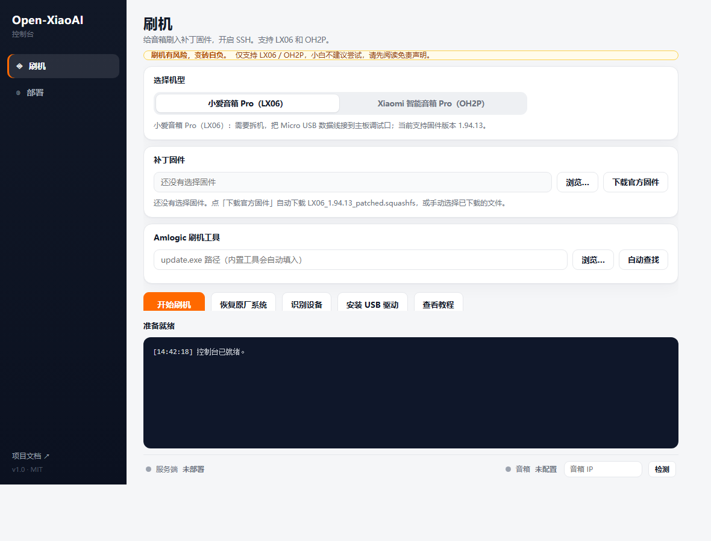
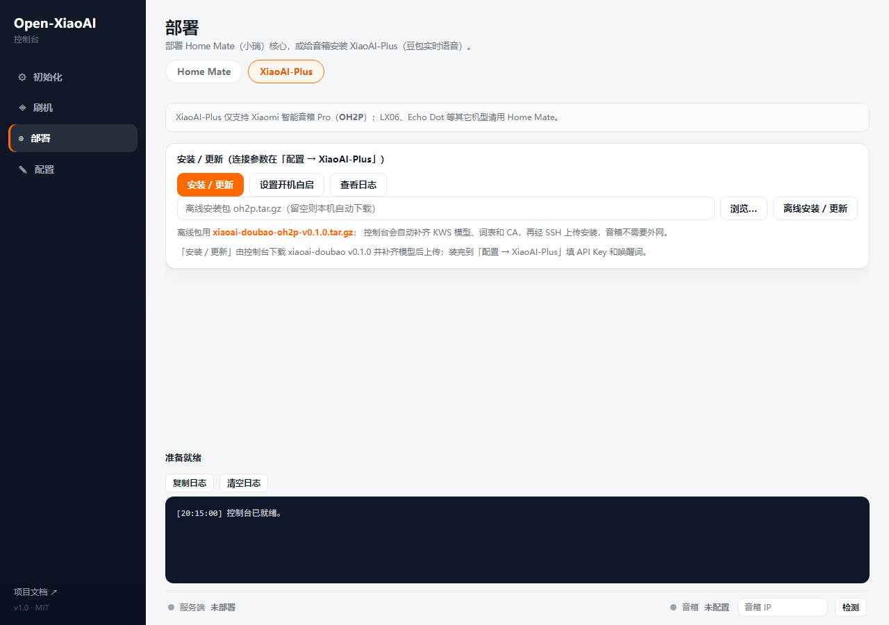

> [!WARNING]
> **刷机有风险，变砖自负。**
>
> - 本项目会修改音箱固件，可能导致设备无法开机、失去保修或无法恢复；
> - **不建议零基础用户尝试**，需要一定的动手能力、命令行操作能力和排错能力；
> - 仅支持 **小爱音箱 Pro（LX06）** 和 **Xiaomi 智能音箱 Pro（OH2P）**，其他型号请勿使用；
> - 刷机前请确保电源稳定、USB 数据线可靠，并自行备份重要数据；
> - 本项目按「现状」提供，不提供任何担保，使用后果由你自行承担。

# Open-XiaoAI Console

小爱音箱**刷机 + 服务端部署**的图形控制台，支持：

- 小爱音箱 Pro（LX06）
- Xiaomi 智能音箱 Pro（OH2P）

> 本项目是 [Open-XiaoAI](https://github.com/idootop/open-xiaoai) 的图形化分支。刷机、部署的核心逻辑来自上游，控制台部分为本分支新增；上游已归档，本分支只维护控制台相关代码。
>
> 控制台目前只支持 **Windows 10 / 11**（依赖系统自带的 WebView2）。

## 功能

- **刷机**：官方固件下载 + SHA256 校验、自动抓上电窗口、`bulkcmd` 重试、错误翻译、一键恢复原厂
- **部署**：小智 AI / MiGPT / Gemini Live，支持本机 Docker 或远程服务器（SSH）
- **源码构建**：本地下载源码 → 打包上传 → 服务器解压构建（适配 ARM / 小内存）
- **初始化**：自动检测并安装 Python（支持自定义目录），缺什么装什么
- **状态栏**：服务端端口和音箱在线检测
- **不内置二进制**：Python 安装包和 Amlogic 刷机工具都在首次使用时按提示下载

## 快速开始

1. 克隆或下载本仓库；
2. 双击 `packages/flash-gui-py/启动控制台.cmd`；
3. 首次启动会打开初始化页面，按提示安装 Python 和界面依赖；
4. 把 Amlogic 刷机工具的 zip 放进 `packages/flash-gui-py/tools/`（页面里有官网下载入口）；
5. 回到控制台，选择机型、固件和刷机工具，开始刷机。

详细说明见 [控制台文档](packages/flash-gui-py/README.md)。

## 支持机型

| 机型 | 固件版本 |
|---|---|
| 小爱音箱 Pro（LX06） | 1.94.13 |
| Xiaomi 智能音箱 Pro（OH2P） | 1.58.6 |

其他型号请勿使用，刷错固件有变砖风险。

## 仓库内容

| 目录 | 说明 |
|---|---|
| `packages/flash-gui-py/` | 图形控制台（本分支主要新增内容） |
| `examples/` | 部署模板和 Dockerfile，**部署页依赖，勿删** |
| `packages/client-rust/` | 音箱端 Client，部署构建会 `COPY` 它，**勿删** |
| `packages/client-patch/`、`packages/runtime/` | 固件构建与运行环境（上游） |
| `docs/` | 刷机与使用文档 |

## 风险与免责声明

> 刷机有风险，变砖自负；继续使用即表示你已理解并接受以下内容。

- **设备与机型**：刷机可能导致设备无法开机、失去保修或无法恢复；仅支持 LX06（1.94.13）和 OH2P（1.58.6），刷错固件后果自负。
- **非官方与第三方工具**：本项目与小米集团无隶属或授权关系；Amlogic 刷机工具为闭源软件，需自行从官方渠道下载并评估风险，本项目不分发其二进制。
- **用途与责任**：仅供个人学习研究，禁止商业或违法用途；项目按「现状」提供、不提供担保，API Key、对话内容和费用由你自行承担，作者不对任何损失负责。

继续使用即表示你已阅读并同意[用户协议](agreement.md)。

## License

MIT License © 2024-PRESENT [Del Wang](https://del.wang)
