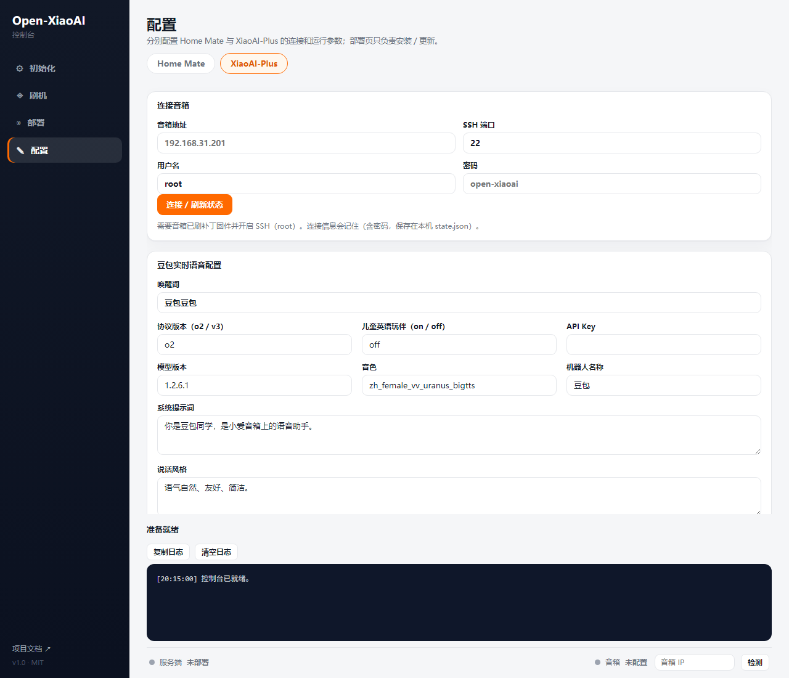

> [!WARNING]
> 刷机有风险，变砖自负。仅支持 LX06 / OH2P，**小白不建议尝试**，需要一定的动手能力和排错能力；请自行备份并承担后果。

# Open-XiaoAI Console

小爱音箱**刷机 + 服务端部署**的图形控制台，支持：

- 小爱音箱 Pro（LX06）
- Xiaomi 智能音箱 Pro（OH2P）

> 本项目是 [Open-XiaoAI](https://github.com/idootop/open-xiaoai) 的图形化分支。刷机、部署的核心逻辑来自上游，控制台部分为本分支新增；上游已归档，本分支只维护控制台相关代码。
>
> 控制台目前只支持 **Windows 10 / 11**（依赖系统自带的 WebView2）。

## 下载

- **XiaoAI-Plus 部署包**：[Releases · v0.1.0](https://github.com/MiKoYi/open-xiaoai-console/releases/tag/v0.1.0)（`oh2p.tar.gz`）
- **OH2P 1.60.2 补丁固件**：[Releases · firmware-oh2p-1.60.2](https://github.com/MiKoYi/open-xiaoai-console/releases/tag/firmware-oh2p-1.60.2)

## 功能

- **刷机**：官方固件下载 + SHA256 校验、自动抓上电窗口、`bulkcmd` 重试、错误翻译、一键恢复原厂
- **部署**：Home Mate（小瑞）核心（Docker + 内嵌其控制台）/ XiaoAI-Plus（音箱端豆包实时语音，在线或离线安装）
- **配置**：左侧独立配置页，分别配置 Home Mate（管理地址 / SSH 部署参数）与 XiaoAI-Plus（SSH 连接 + API Key / 唤醒词 / 模型等）
- **源码构建**：本地下载源码 → 打包上传 → 服务器解压构建（适配 ARM / 小内存）
- **初始化**：控制台左侧「初始化」检查 Python、pywebview、paramiko 和刷机工具，缺依赖一键安装
- **状态栏**：服务端端口和音箱在线检测
- **仓库不放二进制**：Python 安装包和 Amlogic 刷机工具都不提交

## 快速开始

1. 安装 **Python 3.9+**（未检测到时启动会弹窗提示并给出下载页）；
2. 克隆或下载本仓库；
3. 双击 `packages/flash-gui-py/启动控制台.cmd`；
4. 打开左侧「初始化」，安装缺失的依赖（pywebview / paramiko）；
5. 把 Amlogic 刷机工具 zip 放进 `packages/flash-gui-py/tools/`（「初始化」菜单里有下载入口）；
6. 回到刷机页，选择机型、固件和刷机工具，开始刷机。

初始化完成前，「刷机」「部署」菜单是锁定的；依赖装好后点「下一步：刷机」进入控制台。

启动脚本会自动创建 `.venv` 并安装窗口依赖 pywebview；paramiko 和刷机工具在控制台的「初始化」菜单里检查和安装。

详细说明见 [控制台文档](packages/flash-gui-py/README.md)。

## 支持机型

| 机型 | 固件版本 |
|---|---|
| 小爱音箱 Pro（LX06） | 1.94.13 |
| Xiaomi 智能音箱 Pro（OH2P） | 1.60.2 |

> OH2P 1.60.2 补丁固件见 [固件 Release](https://github.com/MiKoYi/open-xiaoai-console/releases/tag/firmware-oh2p-1.60.2)；控制台会优先使用 `packages/flash-gui-py/firmware/OH2P_1.60.2_patched.squashfs` 本地文件，也可以点「浏览」手动选择。

其他型号请勿使用，刷错固件有变砖风险。

## 仓库内容

| 目录 | 说明 |
|---|---|
| `packages/flash-gui-py/` | 图形控制台（本分支主要新增内容） |
| `examples/` | 部署模板和 Dockerfile，**部署页依赖，勿删** |
| `packages/client-rust/` | 音箱端 Client，部署构建会 `COPY` 它，**勿删** |
| `packages/client-patch/`、`packages/runtime/` | 固件构建与运行环境（上游） |
| `docs/` | 刷机与使用文档 |

## 免责声明

- 本项目为第三方开源项目，与小米集团、火山引擎/字节跳动及其关联方无隶属、合作或授权关系；相关商标、固件、云服务的权利归各自权利人。
- 本项目仅供学习研究和个人测试，请遵守当地法律法规及设备用户协议，不得用于商业侵权、网络攻击、数据窃取或系统破坏等场景。
- 刷机、修改系统或安装第三方程序可能导致设备损坏、失去保修或服务终止；请先备份，操作风险由使用者自行承担。
- 第三方组件、模型和固件分别遵循各自许可，详见 [THIRD_PARTY.md](THIRD_PARTY.md)。如权利人认为内容不当，请联系删除；使用者应停止使用并删除相关文件。

使用前请阅读[用户协议](agreement.md)。

## License

MIT License © 2024-PRESENT [Del Wang](https://del.wang)
