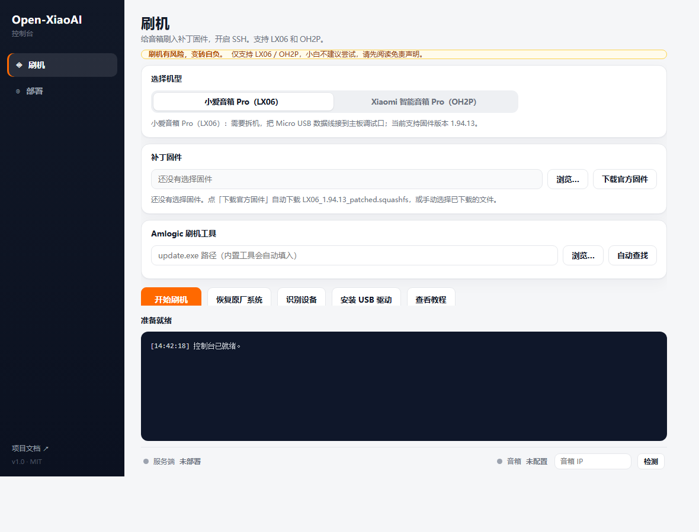
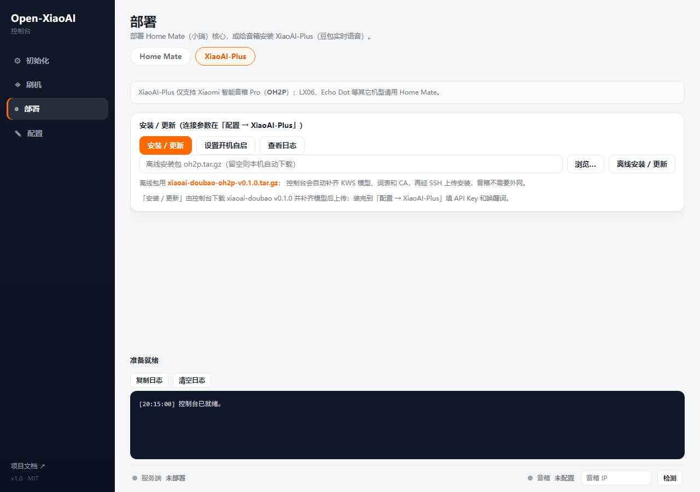

> [!WARNING]
> **刷机有风险，小白不建议尝试。** 仅支持 LX06 / OH2P，刷错固件可能变砖；使用前请先阅读[免责声明](../../README.md)。

# Open-XiaoAI 控制台

需要 **Python 3.9+**。双击 `启动控制台.cmd` 后会自动创建/复用 `.venv`、安装窗口依赖 pywebview，然后打开控制台；没有检测到 Python 时会弹窗提示先安装。

paramiko 和刷机工具在控制台左侧「初始化」菜单里安装，不再单独提供初始化页面。





## 一键启动

双击 **`启动控制台.cmd`**：

- 检测到 Python 3.9+ → 自动创建 `.venv`，安装窗口依赖 pywebview，启动控制台；
- 没有 Python → 弹窗提示先安装，可以直接打开 Python 下载页。

依赖和刷机工具都在控制台左侧的「初始化」菜单里检查和安装：

| 项目 | 操作 |
|---|---|
| pywebview / paramiko | 点「安装依赖」，走清华 PyPI 镜像 |
| 刷机工具 | 点「下载工具」去官网下载 zip，放进 `tools\` |

- 依赖安装日志直接显示在「初始化」页面。
- 安装完 pywebview 后重启控制台，即可使用窗口模式；未安装时以浏览器模式运行。
- 初始化完成前「刷机」「部署」菜单是锁定的；装好依赖后点「下一步：刷机」进入。

### 安装包与工具

仓库不提交 Python 安装包和刷机工具二进制：

| 文件 | 获取方式 |
|---|---|
| Python | 自行安装 3.9+；启动脚本检测不到会弹窗提示下载页 |
| Amlogic 刷机工具 | 控制台「初始化」→「下载工具」去[下载地址](https://www.mediafire.com/file/1m9x18q1klcj5ds/Amlogic_Flash_Tool_v6.0.0.zip/file)下载 zip，放进 `tools\` |

- 安装依赖走清华 PyPI 镜像，需要联网。
- `tools/` 下放 zip 或解压好的文件夹都行，会自动解压并找到 `update.exe`。
- `tools/` 下的二进制已经写进 `.gitignore`，不会误提交。

## 功能

### 刷机

- 机型：小爱音箱 Pro（LX06）/ Xiaomi 智能音箱 Pro（OH2P）
- 固件：官方 Release 下载 + SHA256 校验，或手动选择
- 固件下载自动尝试 ghproxy.net / gh-proxy.com / ghfast.top，失败回退 GitHub 直连；可在「部署 → 高级选项」更换下载源
- 支持下载补丁固件、下载官方固件，以及用 Docker（本机或远程 SSH）把官方固件制作成补丁固件；没有 Docker 时提供 [手动教程](../../docs/patch.md)
- 刷机工具：优先用内置的 `tools/`，也可以浏览选择
- 自动抓上电窗口、`bulkcmd` 重试、错误翻译、一键恢复原厂
- 固件、工具路径、机型都会记住

### 部署

- 按 `examples/` 文档选择接入方式：小智 AI、MiGPT
- 表单化配置：唤醒词、OTA/WebSocket 地址、API Key、模型、系统提示词
- 部署到本机 Docker 或远程服务器（SSH，密码/私钥）
- 源码构建：本机下载源码 → 打包上传 → 服务器解压构建（ARM / 小内存）
- 源码下载源：自动 / 直连 / ghfast.top / ghproxy.net / hub.gitmirror.com / 自定义
- 容器内存上限、端口映射

### 状态栏

- 服务端：TCP 检测部署端口，绿点在线 / 红点离线 / 灰点未部署
- 音箱：SSH 22 端口 → ping 兜底
- 每 15 秒自动检测，也可以手动点「检测」

### 初始化

- 检查 Python 版本、pywebview / paramiko 是否安装
- 一键安装依赖（清华 PyPI 镜像），安装日志显示在页面
- 检查 / 解压 `tools/` 下的刷机工具

## 目录结构

```
packages/flash-gui-py/
├── 启动控制台.cmd          # 双击入口（调用 bootstrap.ps1）
├── bootstrap.ps1           # 查找 Python / 创建 .venv / 启动控制台
├── tools/                  # 放晶晨刷机工具 zip（不提交）
├── web/
│   ├── index.html          # 控制台界面结构
│   ├── style.css           # 样式
│   └── app.js              # 交互逻辑
├── web_app.py              # pywebview 窗口入口
├── web_server.py           # 本地 HTTP + SSE 桥接
├── flash_core.py           # 刷机逻辑
├── deploy_core.py          # 部署逻辑
├── tooling.py              # 内置工具 zip 解压 / 查找
└── tests/                  # 单元测试
```

## 开发与调试

```bash
# 直接用浏览器打开（不需要 pywebview）
python web_app.py --browser

# 只启动服务并检查接口
python web_app.py --selftest

# 测试
python -m unittest discover -s tests -v
```

当前 67 项测试：刷机核心 22 项 + 部署核心 31 项 + 状态检测 3 项 + Web 接口 6 项 + 内置工具解压 5 项，不需要 Docker、音箱或浏览器。

## 安全说明

- SSH 密码只在内存里，不落盘；
- API Key 会明文写进 `deploy/` 下的配置文件（Docker 挂载需要），不要提交；
- `state.json` 只保存界面选项和 IP，不保存密钥；
- 不要把 4399 端口直接暴露到公网；
- 刷机有变砖风险，请确认机型和固件版本。
