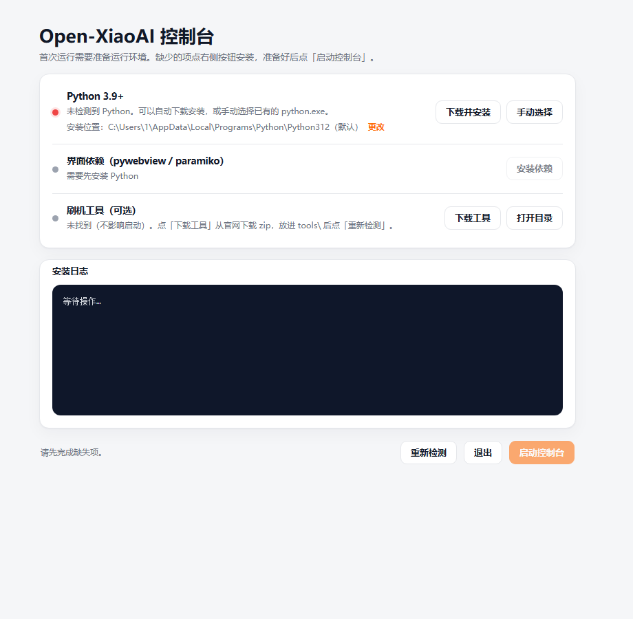

> [!WARNING]
> **刷机有风险，小白不建议尝试。** 仅支持 LX06 / OH2P，刷错固件可能变砖；使用前请先阅读[免责声明](../../README.md)。

# Open-XiaoAI 控制台

一个窗口搞定「刷机 + 服务端部署」，界面是 HTML / pywebview，不再用 tkinter 原生控件。

双击就能用：机器上没有 Python 也可以，会先打开一个**初始化页面**，缺什么、点哪个按钮安装都写清楚。




## 一键启动

双击 **`启动控制台.cmd`**：

- 环境齐全 → 直接打开控制台；
- 缺 Python 或依赖 → 浏览器 / Edge 打开初始化页面（就是上面第一张图）。

初始化页面会列出三项：

| 项目 | 状态 | 操作 |
|---|---|---|
| Python 3.9+ | 已安装 / 未检测到 | **下载并安装**（自动下载官方安装包）或 **手动选择** `python.exe` |
| 界面依赖 | 已安装 / 缺少 | 点「安装依赖」，从 PyPI 镜像在线安装 |
| 刷机工具 | 已找到 / 未找到 | 可选，点「下载工具」去官网下载，或「打开目录」放入 zip |

- Python 安装**不是静默的**：点「下载并安装」会先下载官方安装包，下载完成后弹出安装程序（`/passive` 显示进度），装完页面自动刷新。
- **可以自定义安装位置**：Python 那一行的「更改」可以选目录（默认是 `%LocalAppData%\Programs\Python\Python312`），安装时通过 `TargetDir` 传给官方安装程序；选过会记住，点「恢复默认」清除。
- 下载地址优先用国内镜像（npmmirror），失败自动切到 python.org；也可以把手动下载的安装包放到 `installer\` 目录，页面会直接用它。
- 手动选择会打开文件选择框，选已有的 `python.exe`（3.9+），路径会记住。
- 安装日志直接显示在页面里。
- 全部就绪后点「启动控制台」，初始化页面退出，打开 pywebview 窗口。

如果环境已经正常，只想重新配置，可以运行：

```powershell
powershell -File bootstrap.ps1 -Setup
```

### 安装包与工具

为了能直接上传 GitHub，仓库里**不再提交**这两类大文件：

| 文件 | 获取方式 |
|---|---|
| Python 安装包 | 初始化页点「下载并安装」自动下载；或手动放到 `installer\python-3.12.7-amd64.exe` |
| Amlogic 刷机工具 | 点「下载工具」去[官网](https://androidmtk.com/download-amlogic-flash-tool)下载 zip，放进 `tools\` |

- 安装依赖时走清华 PyPI 镜像，失败会再试阿里云镜像，需要联网。
- `tools/` 下放 zip 或解压好的文件夹都行，初始化时会自动解压并找到 `update.exe`。
- `installer/` 和 `tools/` 下的二进制已经写进 `.gitignore`，不会误提交。

## 功能

### 刷机

- 机型：小爱音箱 Pro（LX06）/ Xiaomi 智能音箱 Pro（OH2P）
- 固件：官方 Release 下载 + SHA256 校验，或手动选择
- 刷机工具：优先用内置的 `tools/`，也可以浏览选择
- 自动抓上电窗口、`bulkcmd` 重试、错误翻译、一键恢复原厂
- 固件、工具路径、机型都会记住

### 部署

- 按 `examples/` 文档选择接入方式：小智 AI、MiGPT、Gemini Live
- 表单化配置：唤醒词、OTA/WebSocket 地址、API Key、模型、系统提示词
- 部署到本机 Docker 或远程服务器（SSH，密码/私钥）
- 源码构建：本机下载源码 → 打包上传 → 服务器解压构建（ARM / 小内存）
- 源码下载源：自动 / 直连 / ghfast.top / ghproxy.net / hub.gitmirror.com / 自定义
- Docker 镜像加速前缀、容器内存上限、端口映射

### 状态栏

- 服务端：TCP 检测部署端口，绿点在线 / 红点离线 / 灰点未部署
- 音箱：SSH 22 端口 → ping 兜底
- 每 15 秒自动检测，也可以手动点「检测」

## 目录结构

```
packages/flash-gui-py/
├── 启动控制台.cmd          # 双击入口（调用 bootstrap.ps1）
├── bootstrap.ps1           # 初始化页的本地服务（检测 / 下载 / 安装 / 启动）
├── installer/
│   ├── README.md
│   └── download_python.ps1 # 自动下载 Python 安装包（镜像优先）
├── tools/                  # 放晶晨刷机工具 zip（不提交）
├── setup/
│   ├── index.html          # 初始化页面
│   ├── setup.css
│   └── app.js
├── web/
│   ├── index.html          # 控制台界面结构
│   ├── style.css           # 样式
│   └── app.js              # 交互逻辑
├── web_app.py              # pywebview 窗口入口
├── web_server.py           # 本地 HTTP + SSE 桥接
├── flash_core.py           # 刷机逻辑
├── deploy_core.py          # 部署逻辑
├── tooling.py              # 内置工具 zip 解压 / 查找
└── tests/                  # 单元测试
```

## 开发与调试

```bash
# 直接用浏览器打开（不需要 pywebview）
python web_app.py --browser

# 只启动服务并检查接口
python web_app.py --selftest

# 测试
python -m unittest discover -s tests -v
```

当前 63 项测试：刷机核心 18 项 + 部署核心 31 项 + 状态检测 3 项 + Web 接口 6 项 + 内置工具解压 5 项，不需要 Docker、音箱或浏览器。

## 安全说明

- SSH 密码只在内存里，不落盘；
- API Key 会明文写进 `deploy/` 下的配置文件（Docker 挂载需要），不要提交；
- `state.json` 只保存界面选项和 IP，不保存密钥；
- 不要把 4399 端口直接暴露到公网；
- 刷机有变砖风险，请确认机型和固件版本。
